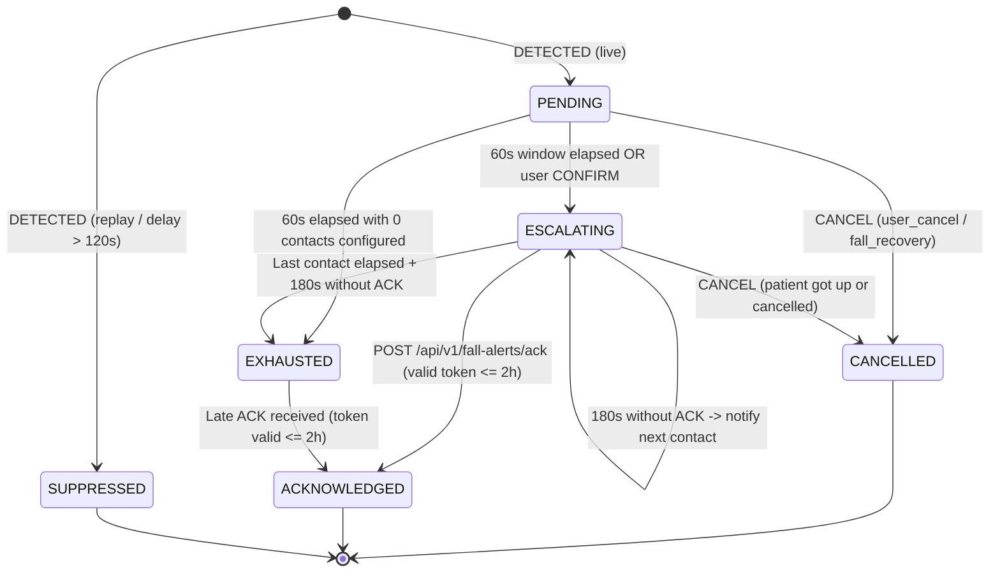

# HealthKicks Backend

FastAPI Cloud API for the **HealthKicks** connected smart shoe ecosystem: remote haptic stimulation commands, activity event tracking, fall detection alerting & sequential emergency escalation, AWS IoT ingestion webhooks, and Studio telemetry curation.

---

## Architecture

- `app/main.py`: Assembles the stateless FastAPI Cloud API, lifecycle hooks, background workers, and database migrations.
- `app/api/v1/`: Exposes REST endpoints (authentication, devices, haptics, activities, fall alerts & emergency contacts, steps sync, studio sessions, and the `/api/v1/ingest/event` & `/api/v1/internal/fall-alerts` webhooks).
- `app/db/database.py`: Synchronous SQLAlchemy engine sessions, connection pool resilience, and automatic AWS RDS IAM DB authentication.
- `app/db/models.py`: Declares database persistence models (`Device`, `DeviceOwnership`, `ActivityEvent`, `FallAlert`, `FallAlertNotification`, `AlertContact`, `DailyStepsSync`, `HapticLog`, `User`, `StudioSession`, and the idempotent message ledger).
- `app/schemas/`: Strict Pydantic v2 validation contracts and DTO schemas.
- `app/services/aws_iot_service.py`: Dispatches AWS IoT MQTT commands via boto3 `iot-data` without a persistent MQTT client.
- `app/services/email_service.py`: Formats and delivers emergency alert emails via SMTP (STARTTLS) and Paris-localized timestamps.
- `app/services/fall_alert_service.py`: Orchestrates the sequential emergency escalation worker, HMAC token generation/verification, SMS downlink command formatting, and transition states.
- `app/services/telemetry_service.py`: Interfaces with Amazon DynamoDB for high-frequency IMU telemetry storage, time-range queries, and dataset aggregation.
- `app/services/ingestion_service.py`: Validates and persists incoming edge sensor events.
- `app/core/config.py`: Loads `config.yaml` and handles environment variable overrides.

---

## Fall Alerting & Emergency Escalation

The backend includes a stateful, robust escalation engine for fall incidents:



- **Dual-Channel Notification**: Alerts contacts sequentially by priority. For each contact, dispatches an **Email (SMTP)** and, if a phone number is registered, publishes an **SMS Command** via MQTT Downlink (`healthkicks/v1/users/{user_id}/fall-alert/status`) for local GSM transmission by the patient's phone.
- **Direct Frontend Link Generation**: Builds SMS & Email links pointing straight to the Angular frontend: `${frontend_url}/fall-alerts/ack?token=${token}`.
- **Safe Read-Only Inspection**: `GET /api/v1/fall-alerts/ack/info?token=...` enables the frontend to fetch alert details without triggering state changes (immune to link preview bots).
- **Explicit Acknowledgment**: `POST /api/v1/fall-alerts/ack` receives a JSON payload `{"token": "..."}`, validates the HMAC signature and expiration (2 hours), updates state to `ACKNOWLEDGED`, halts further escalation, and publishes confirmation to the patient's phone.

---

## Installation & Running with uv

```powershell
# Install dependencies
uv sync

# Run development server
uv run uvicorn app.main:app --host 0.0.0.0 --port 8000 --reload
```

The application defaults to PostgreSQL specified via `DATABASE_URL` (with optional `USE_RDS_IAM=true` for token-based RDS IAM authentication).
The health endpoint `GET /api/v1/health` verifies database connectivity and returns `status: "ok"` or `"degraded"`.

---

## REST Endpoints Overview

### Authentication & Users
- `POST /api/v1/auth/google/callback`: Exchange Google OAuth2 authorization code for JWT tokens.
- `POST /api/v1/auth/azure/callback`: Exchange Microsoft Entra ID code for JWT tokens.
- `POST /api/v1/auth/refresh`: Refresh expired access token with token rotation.
- `GET /api/v1/users/me`: Current user profile information and role.

### Devices & Haptics
- `GET /api/v1/devices`: List registered devices (or user-bound devices).
- `POST /api/v1/devices/{device_id}/haptic/trigger`: Trigger remote haptic vibration command.
- `GET /api/v1/devices/{device_id}/haptic/history`: Paginated log of haptic commands.

### Activity Events & Steps
- `GET /api/v1/devices/{device_id}/events/activities`: Paginated list of detected activity and fall events.
- `POST /api/v1/steps/sync`: Synchronize daily step count aggregates from mobile odometry.
- `GET /api/v1/steps/history`: Query daily step history with activity breakdowns.

### Fall Alerting & Emergency Contacts
- `GET /api/v1/users/me/alert-contacts`: List emergency contacts ordered by priority (1..5).
- `POST /api/v1/users/me/alert-contacts`: Register a new emergency contact (email required, phone optional).
- `PUT /api/v1/users/me/alert-contacts/order`: Reorder priority list.
- `PATCH /api/v1/users/me/alert-contacts/{contact_id}`: Update contact names, email, or phone.
- `DELETE /api/v1/users/me/alert-contacts/{contact_id}`: Remove contact and re-compact priorities.
- `POST /api/v1/users/me/alert-contacts/{contact_id}/test-email`: Dispatch a test verification email and optional SMS command.
- `GET /api/v1/fall-alerts`: Paginated fall alerts history with state/date filters and RBAC isolation.
- `GET /api/v1/fall-alerts/{alert_id}`: Full detail and audit timeline of a specific fall alert.
- `GET /api/v1/fall-alerts/ack/info`: Public, safe read-only endpoint returning alert metadata for a signed token.
- `POST /api/v1/fall-alerts/ack`: Public confirmation endpoint acknowledging an alert and halting escalation.

### Studio Mode & Telemetry
- `GET /api/v1/studio/sessions`: Paginated historical studio capture sessions with RBAC and label filters.
- `GET /api/v1/studio/sessions/{id}/readings`: Fetch raw IMU sensor frames from DynamoDB for inspection.
- `PATCH /api/v1/studio/sessions/{id}`: Reclassify studio session label in PostgreSQL and DynamoDB.
- `PATCH /api/v1/studio/sessions/{id}/trim`: Non-destructive trimming of studio recording bounds.
- `DELETE /api/v1/studio/sessions/{id}`: Purge studio session and associated raw telemetry frames.

### Ingestion Webhooks
- `POST /api/v1/ingest/event`: General edge activity and fall detection webhook from AWS IoT rules.
- `POST /api/v1/internal/fall-alerts`: Stateful fall alerting webhook (`DETECTED`, `CONFIRM`, `CANCEL`, `SMS_STATUS`).

---

## Local Docker Stack

```powershell
docker compose up --build
```

Runs a local PostgreSQL 16 instance, applies Alembic migrations, and launches the FastAPI application.

---

## Running Tests

```powershell
uv run pytest
```

---

## Configuration

Default values are stored in [config.yaml](config.yaml).
The configuration file path can be customized with `HEALTHKICKS_CONFIG_FILE`.

Key environment variables:
- `DATABASE_URL`: PostgreSQL connection string.
- `USE_RDS_IAM`: Set to `true` when running on AWS with IAM role authentication.
- `FRONTEND_URL` / `HEALTHKICKS_FRONTEND_URL`: Public Angular frontend URL (e.g. `https://healthkicks.duckdns.org` or `http://localhost:4200`).
- `HEALTHKICKS_INGEST_TOKEN`: Shared secret for internal ingestion webhooks.
- `HEALTHKICKS_JWT_SECRET`: Signing secret for JWT access tokens.
- `AWS_REGION`: AWS target region (default: `eu-north-1`).
- `AWS_IOT_ENDPOINT`: AWS IoT Core REST endpoint for publishing commands.
- `DYNAMODB_TELEMETRY_TABLE`: DynamoDB table name (default: `healthkicks_telemetry`).
- `SMTP_HOST`, `SMTP_PORT`, `SMTP_USER`, `SMTP_PASSWORD`: SMTP credentials for emergency email alerts.
- `FALL_ALERT_ACK_SECRET`: Secret key used for signing acknowledgment HMAC tokens.
- `FALL_ALERT_ACK_TOKEN_TTL_SEC`: Token validity duration (default: `7200` seconds / 2 hours).
- `FALL_ALERT_CANCEL_WINDOW_SEC`: Time window before escalation begins (default: `60` seconds).
- `FALL_ALERT_ESCALATION_STEP_SEC`: Time between successive contacts (default: `180` seconds / 3 minutes).

---

## Machine Learning (Edge Activity Classification & Fall Detection)

A complete local ML training, benchmarking, and embedded transpilation pipeline is available to train lightweight classifiers and automatically deploy them to the ESP32-S3 firmware.

### 1. Unified End-to-End MLOps Pipeline (`scripts.update_edge_model`)

The [`scripts/update_edge_model.py`](scripts/update_edge_model.py) script automates the complete model lifecycle in a single command:
1. **Incremental Data Ingestion**: Synchronizes validated Studio sessions from PostgreSQL and DynamoDB.
2. **Cross-Validation Training**: Benchmarks candidate algorithms via 5-Fold Stratified Cross-Validation optimizing for macro F1-score.
3. **Quality Gate Verification**: Enforces minimum F1-score standards (default: $\ge 85\%$).
4. **C Transpilation**: Converts the champion model into embedded C code (`include/activity_model_generated.h`) via `m2cgen`.
5. **Firmware Integrity Check**: Automatically verifies ESP32-S3 firmware compilation via PlatformIO.

```powershell
# Install ML dependencies in virtualenv
uv sync --group ml

# Authenticate with AWS CLI for live telemetry data
aws sso login   # or aws login / aws configure

# Full end-to-end sync, train, export to C, and firmware build check
uv run python -m scripts.update_edge_model

# Fast offline run with synthetic dataset (no AWS or database connection required)
uv run python -m scripts.update_edge_model --synthetic

# Skip retraining and re-transpile existing model artifact directly
uv run python -m scripts.update_edge_model --skip-train

# Export to C header without running the PlatformIO build check
uv run python -m scripts.update_edge_model --no-build-check
```

### 2. Standalone Training & Hyperparameter Tuning (`scripts.train_detector`)

For detailed model comparison, feature extraction tuning, or custom cross-validation:

```powershell
# Train classifiers with incremental PostgreSQL & DynamoDB caching
uv run python -m scripts.train_detector

# Synthetic offline training
uv run python -m scripts.train_detector --synthetic
```

For full architecture and parameters details, refer to the [Machine Learning Training Guide](docs/ML_TRAINING.md).
